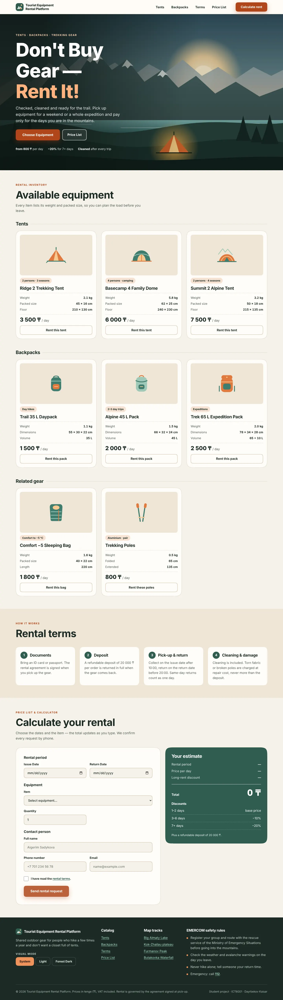

# Tourist Equipment Rental Platform

ICT6001 · Laboratory Work No. 9 · Student: Dayrbekov Kaisar

A web catalog for a gear-sharing service: tents, backpacks and related equipment, with an interactive rental-period calculator. Mobile-first, semantic HTML5, CSS Grid + Flexbox, relative units, Light / Forest Dark themes.

**Live site:** `https://<your-github-username>.github.io/tourist-rental/` ← replace after publishing



---

## 1. Project structure

```
tourist-rental/
├── index.html          ← all 5 components, semantic tags only (0 <div>)
├── style.css           ← mobile-first styles, rem/em/%/vh/vw, one 1024px query
├── script.js           ← rental calculator, theme memory, menu comfort
├── images/             ← export-ready assets
│   ├── hero.webp           (desktop hero, 1920×1200, raster → WebP)
│   ├── hero-mobile.webp    (phone hero, 1080×1728 portrait crop)
│   ├── logo.svg, favicon.svg
│   └── tent*.svg, backpack*.svg, sleeping-bag.svg, poles.svg (vector icons)
├── design-src/         ← editable sources (hero.svg → import into Figma)
└── docs/               ← reference screenshots 1440 / 390, light / dark
```

Open `index.html` in a browser, or run a local server: `python3 -m http.server` → http://localhost:8000.

## 2. How each component meets the task

| Component | Implementation |
|---|---|
| **Header / Nav** | Desktop ≥1024px: sticky horizontal `display:flex` bar. Phones: bottom app bar (thumb zone) with a round burger button that opens a **sliding side panel** — the native `popover` attribute, so it opens/closes without JavaScript; `translate` + `@starting-style` animate the slide. |
| **Hero** | Landscape background (`hero.webp` / `hero-mobile.webp`) under a dark gradient, `h1` "Don't Buy Gear — Rent It!", CTA **Choose Equipment**. On phones the text and CTA sit in the lower third of the screen. |
| **Grid** | One `grid-template-columns: repeat(var(--cols), 1fr)` matrix. `--cols` is 4 on phones (card spans 4 = single column), 2 cards per row from 40em, 12 columns on desktop (card spans 4 = 3 per row). Cards are `<article>` with a `<dl>` for weight / dimensions and the price per day. |
| **Feedback form** | Issue Date, Return Date (`type="date"`), item `select`, quantity (`type="number" min max`), full name (`minlength`), phone (`type="tel"` + `pattern`), email (`type="email"`), consent checkbox — all `required`. Pure-CSS validation: `:user-invalid` turns the border red and reveals the error text; `:user-valid` turns it green. The return date's `min` follows the issue date, so the browser rejects a return before the issue. |
| **Calculator** | Days × price per day × quantity, −10% for 3–6 days, −20% for 7+ days, same-day return = 1 day. Results go into `<output>` elements; the "Rent this…" buttons on cards pre-select the item. |
| **Footer** | Catalog links, map-track links (OpenStreetMap), EMERCOM safety rules + 112, legal block, and the **System / Light / Forest Dark** switch. The switch is radio buttons + CSS `:root:has(#theme-dark:checked) { color-scheme: dark }`; every color is a `light-dark()` token. JS only remembers the choice in `localStorage`. |

## 3. Checklist self-check (HTML/CSS, 40 pts)

- **Semantics:** `header`, `nav`, `main`, `section`, `article`, `aside`, `footer`, `figure`, `fieldset`, `output`; **no `<div>` at all**.
- **Layout:** only Grid and Flexbox; no `<table>`, no `float`.
- **Units:** no `px` in `style.css` except the required `@media (min-width: 1024px)`; sizes are `rem`, `em`, `%`, `vh`, `vw`, `svh`, `dvh`.
- **Responsive:** tested at 320, 390, 768, 1024 and 1440 px — page width equals viewport width, no horizontal scrollbar.
- **Form:** `type="email"`, `type="tel"`, `type="date"`, `required`, `pattern`, `min`/`max`, `minlength`.
- **Contrast (WCAG AA ≥ 4.5:1):** light text/background 13.4:1, button text 5.6:1, muted text 5.5–6.7:1; Forest Dark text 15.2:1, button 7.9:1, muted 6.9–7.9:1.

## 4. Git — commit history (do this yourself, in order)

The checklist wants at least 3 atomic commits with semantic messages. Committing file by file gives a clean history:

```bash
cd tourist-rental
git init -b main
git config user.name  "Your Name"
git config user.email "you@example.com"     # the email of your GitHub account

git add images design-src
git commit -m "chore: add project structure and exported SVG/WebP assets"

git add index.html
git commit -m "feat: add semantic markup for header, hero, grid, form and footer"

git add style.css
git commit -m "feat: add mobile-first grid layout and burger side panel styles"

git add script.js
git commit -m "feat: add rental period calculator and theme memory"

git add README.md docs
git commit -m "docs: add README with checklist and screenshots"
```

If you change something later, keep the same style: `fix: burger menu mobile styles`, `style: adjust hero spacing`, `refactor: …`.

## 5. GitHub + GitHub Pages

1. On github.com → **New repository** → name `tourist-rental` → **Public** → do **not** add a README (you already have one) → Create.
2. Push:
   ```bash
   git remote add origin https://github.com/<username>/tourist-rental.git
   git push -u origin main
   ```
3. Repository → **Settings → Pages** → Source: *Deploy from a branch* → Branch: `main`, folder `/ (root)` → Save.
4. Wait 1–2 minutes and open `https://<username>.github.io/tourist-rental/`. Paste that link at the top of this README and commit: `docs: add live site link`.

`index.html` must stay in the repository root, otherwise Pages returns 404. File names are case-sensitive on GitHub Pages (`images/hero.webp` ≠ `Images/Hero.webp`).

## 6. Figma layout (25 pts)

Build the layout so it matches the code (defense criterion "Implementation identity").

**Frames**
- `Desktop` 1440 × auto, `Mobile` 390 × auto. Duplicate each for the dark theme → 4 frames: Desktop Light, Desktop Forest Dark, Mobile Light, Mobile Forest Dark. Start with Mobile (Mobile-First).

**Layout grids**
| Frame | Columns | Margin | Gutter | Content width |
|---|---|---|---|---|
| Desktop 1440 | 12, Stretch | 80 | 24 | 1280 |
| Mobile 390 | 4, Stretch | 20 | 16 | 350 |

Same values as the CSS variables `--margin`, `--gutter`, `--content`.

**Where things sit on the grid (desktop)**
- Hero text + CTA: columns 1–7. Cards: 4 columns each (3 per row). Terms: 3 columns each. Form: columns 1–7, estimate card: 8–12. Footer: 4 + 2 + 2 + 4.
- Mobile: everything spans all 4 columns.

**Thumb zone (mobile)** — show it as an annotation layer: bottom app bar with the burger (52px circle) at bottom-right, hero CTA in the lower third, side-panel links aligned to the bottom, full-width submit button. All tap targets ≥ 48px high.

**Color styles** (create as Figma Variables with two modes, Light / Forest Dark)
| Token | Light | Forest Dark |
|---|---|---|
| bg | #F6F2EA | #0F1A16 |
| surface | #FFFDF8 | #16241F |
| tile | #EFE6D6 | #1D2F28 |
| text | #1B2A24 | #E7EFE9 |
| muted | #4F5E57 | #A8BAB1 |
| line | #D9CFBD | #2C4038 |
| brand | #2F5D50 | #8FCBB2 |
| accent | #B0461A | #F0915A |
| accent-ink | #FFFFFF | #1A120A |
| error | #B3261E | #FF9A8F |

Check text layers with the **Contrast** plugin — the pairs above all pass AA.

**Type** — Headings: Bricolage Grotesque ExtraBold (H1 96 desktop / 46 mobile, H2 52 / 32). Body: Manrope 16/26, labels Manrope Bold 15.

**Corners** — cards 32, inputs/buttons 12, enable *Corner smoothing 60–100%* (iOS) on every interactive element — this is the squircle shape; the CSS uses `corner-shape: squircle` where the browser supports it.

**Export** — import `design-src/hero.svg` (drag into Figma), keep it as a group of vector paths; the icons in `images/*.svg` too. Select icons → Export → **SVG**; select the hero → Export → **WebP** (or PNG and convert). Name layers the same as the files.

**Fast route:** the community plugin *html.to.design* can import a live URL into Figma as editable layers. After your site is on GitHub Pages, import it at 1440 and at 390 in both themes, then add the layout grids and clean up the layers. The screenshots in `docs/` are the reference for every frame.

## 7. Defense — short answers

- **Mobile-First:** base CSS is written for the smallest screen (single column, bottom navigation); `@media (min-width: …)` only *adds* columns and changes the layout for larger screens. Smaller devices download and parse the simplest rules; nothing must be "undone".
- **Why min-width 1024px:** from this width there is room for the 12-column grid and a horizontal menu; below it the 4-column phone grid is used (with a 2-cards step at 40em).
- **How the grid adapts:** `grid-template-columns: repeat(var(--cols), minmax(0, 1fr))`. Only `--cols` (4 → 12) and the `grid-column: span N` of the children change. `minmax(0, 1fr)` stops long words from stretching a column and causing horizontal scroll.
- **Grid vs Flexbox:** Grid = two-dimensional (rows and columns: catalog, footer, page skeleton). Flexbox = one direction (nav links, buttons, card content).
- **rem vs em vs px:** `rem` is relative to the root font size (16px default) — respects the user's browser font setting; `em` is relative to the current element; `vh`/`vw` to the viewport; `px` is fixed.
- **Burger menu:** `<nav popover>` + `<button popovertarget="site-nav">`. The browser opens/closes the panel, closes it with Esc or a tap outside, and puts it in the top layer. On desktop the CSS overrides the popover to `display:flex; position:static` so it becomes the normal horizontal menu.
- **CSS validation:** HTML attributes (`required`, `type`, `pattern`, `min`) define what's valid; CSS `:user-invalid` / `:user-valid` style the field only after the user interacts with it, so the form doesn't look "red" on page load.
- **Theme switcher:** `color-scheme` on `:root` decides which half of every `light-dark(light, dark)` color is used; `:has(#theme-dark:checked)` sets it from the radio button. "System" follows the OS setting (`prefers-color-scheme`).
- **Git:** working directory → `git add` (staging) → `git commit` (local history) → `git push` (remote). Atomic commit = one logical change. Conventional prefixes: `feat` new feature, `fix` bug fix, `docs`, `style`, `refactor`, `chore`.
- **GitHub Pages:** static hosting that serves the files of a branch; `index.html` in the root is the entry page.

## Credits

All illustrations and icons are original vector drawings made for this project. Fonts: Google Fonts (Bricolage Grotesque, Manrope, SIL Open Font License). Map links: OpenStreetMap.
